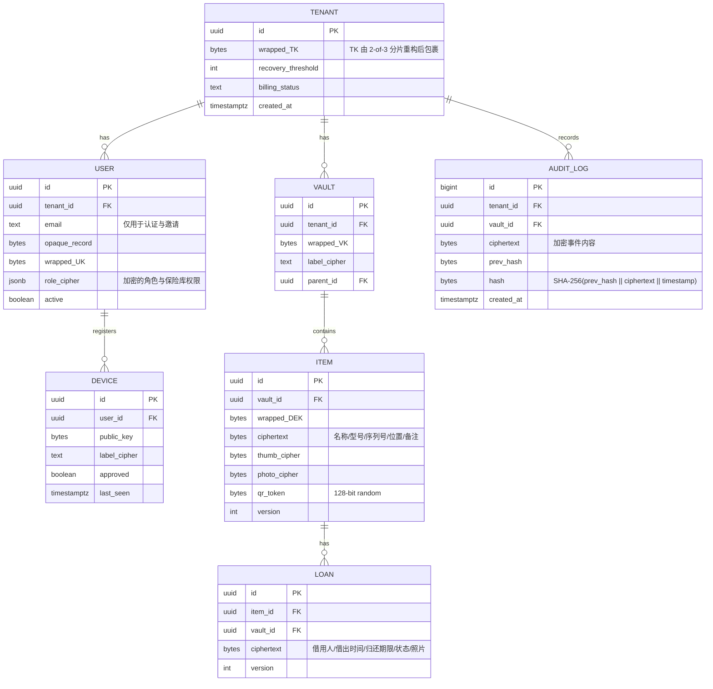

# 器材借还管理系统（方案 C）｜实施方案与技术蓝图 v0.1

> 日期：2026-11-23
> 状态：**设计阶段**。本文只包含方案与蓝图，不含代码实现。
> 定位：面向实验室、维修车间、摄影棚、共享工具间的垂直 B2B 器材借还管理。
> 最高优先级：**安全保密**——平台方与其他租户无法解密查看任何客户数据；组织内部按最小权限授权。

---

## 0. 决策与范围

- 放弃泛 C 端"什么都能管"的物品定位工具，收敛到**高频、有明确付费方**的器材借还场景。
- 核心卖点不是"拍照找东西"，而是：**扫码借还 + 责任到人 + 审计留痕 + 租户数据平台不可见**。
- 交付形态：响应式 Web / PWA，电脑、平板、手机浏览器可用；可安装到桌面；扫码优先。
- 部署：默认境内云多租户 SaaS；预留**单租户自托管**选项，用于满足高保密客户。

**本期产出：** 组织架构、密钥体系、数据模型、权限模型、业务流程、前端蓝图、技术选型、安全控制、分阶段实施计划。

---

## 1. 产品定义与目标客户

### 1.1 一句话定义

组织给每件器材贴上二维码/NFC 标签，借出和归还都扫码，系统自动记录"谁、何时、借了什么、何时还、状态如何"，并提供不可篡改的审计链；所有业务数据在本地加密后上传，平台只存密文。

### 1.2 目标客户与付费方

| 客户类型 | 典型痛点 | 付费意愿 |
|---|---|---|
| 高校/企业实验室 | 仪器借用责任不清、校准过期、盘点费时 | 高（有预算与合规要求） |
| 第三方检测/维修车间 | 工具丢失、跨班组交接扯皮 | 高 |
| 影视器材租赁/摄影棚 | 设备贵重、出租归还状态举证困难 | 高 |
| 共享工具间/创客空间 | 会员借还、逾期管理 | 中高 |

### 1.3 定价假设（待试点验证）

- 组织版：¥299–999/月，含 10–50 席位。
- 额外席位：¥30–60/人/月。
- 自托管授权：¥20,000–50,000/年。
- 免费试点：2–3 家，4 周。

### 1.4 成功指标

- 试点组织周活跃管理员 ≥ 3 天/周；
- 借还扫码次数 ≥ 30 次/组织/周；
- 管理员可在 10 秒内完成一次借出；
- 密钥协议外部评审无高危缺陷；
- 租户隔离测试 100% 通过。

---

## 2. 总体架构与信任边界

```
┌──────────────────────────────────────────────────────────────┐
│                    客户端（浏览器 / PWA）                    │
│  ① 明文 UI：器材、照片、借还人、审计                         │
│  ② 加密层：WebCrypto（AES-256-GCM / Argon2id / HKDF）        │
│  ③ 本地层：IndexedDB 存密文缓存与加密索引                    │
│  ④ 同步层：只上传密文 blob + 版本号 + 设备签名               │
└───────────────────────────┬──────────────────────────────────┘
                            │ 仅密文、 opaque ID、时间戳
┌───────────────────────────▼──────────────────────────────────┐
│                    服务端（零知识）                          │
│  · 认证：OPAQUE，服务端只有 verifier，无口令等价物           │
│  · 存储：PostgreSQL（密文记录）+ 对象存储（密文照片）        │
│  · 审计：密文日志 + 哈希链（平台无法伪造有效链）             │
│  · 同步：通用通知「有更新」，不含业务内容                    │
│  · 计费：订阅状态、席位数量                                  │
│  平台持有：无 TK / UK / VK / DEK / AK 的任何解密副本         │
└──────────────────────────────────────────────────────────────┘
```

**信任边界原则：**

1. 明文只存在于已授权客户端的内存与本地加密缓存中。
2. 服务端只能看到：租户 ID、Vault ID、器材 ID、随机二维码令牌、时间戳、密文字节数、用户邮箱、登录/扫码事件。
3. 平台运维**不能**读取、导出、解密任何业务数据；"break-glass" 必须走 2-of-3 组织恢复分片 + 法务流程，且生成组织可见的审计记录。
4. 客户端代码由服务端下发是 Web 零知识的固有弱点，必须通过 CSP、SRI、构建产物签名、加密模块开源可审来降低风险；高保密客户走自托管部署来消除该风险。

---

## 3. 密钥体系设计（核心）

### 3.1 密钥层级

```
组织恢复分片（Shamir 2-of-3，由组织管理员离线分别保管）
        │ 重构（仅在恢复设备浏览器中完成，从不上传）
        ▼
租户主密钥 TK（每租户一把，256-bit 随机）
   ├── 包裹 → 用户密钥 UK（每位成员一份，用于账号恢复）
   │       └── 口令/OPAQUE randomized password → HKDF → KEK → 包裹 UK
   ├── 包裹 → 保险库密钥 VK（每个 Vault 一把）
   │       └── 包裹 → 器材密钥 DEK（每件器材一把）
   │               └── 加密 → 器材字段 / 原图 / 缩略图 / 维保记录
   └── 包裹 → 审计密钥 AK
           └── 加密 + 哈希链 → 审计日志
```

### 3.2 关键设计说明

| 项目 | 设计 |
|---|---|
| 登录认证 | OPAQUE；服务端不存明文口令或口令等价物。用 OPAQUE 输出的 randomized password 经 HKDF 派生 KEK，避免明文口令参与密钥派生。 |
| 器材加密 | 每件器材独立 DEK；文本、照片、缩略图分别用 AES-256-GCM + 随机 12 字节 IV 加密，带认证标签。 |
| 二维码令牌 | 128-bit 随机 opaque token，不含器材含义；服务端只把它映射到密文记录 ID。 |
| 搜索 | 每个 Vault 维护加密索引，授权客户端下载后本地解密查询；搜索关键词绝不上行。 |
| 恢复机制 | 组织管理员各持 1 份恢复分片，2-of-3 可重构 TK；平台零份。忘记口令的成员由组织管理员用 TK 重新包裹其 UK。 |
| 新成员加入 | 管理员客户端用自己的 UK 解出 TK/VK，为新成员生成 UK 并用 TK 包裹，写入服务端；新成员用口令解出自己的 UK。 |
| 成员离职 | 撤销成员资格 + 轮换其所在 Vault 的 VK + 重新包裹其余成员与器材 DEK + 吊销设备证书。**注意：已下载到离职员工设备的明文无法远程擦除**，需配合组织 MDM/制度。 |
| 密钥轮换 | 支持 UK（改口令）、TK（分片重构后）、VK（成员变动）、DEK（器材敏感信息更新）四级轮换；轮换过程必须在客户端完成并写入审计链。 |
| 设备绑定 | 每台设备生成密钥对，公钥在服务端登记；新设备需管理员批准或 2-of-3 恢复分片 + 二次验证；敏感操作要求已登记设备签名。 |
| 前向保密 | 每次会话密钥独立；轮换 VK 后旧密文无法被新成员解密（按需重新包裹）。 |

### 3.3 明确不做的事

- 不做平台侧"管理员万能钥匙"——那等于把客户数据交给平台。
- 不做云端 AI 识别照片——会破坏零知识；如需要，必须是端侧模型且按需下载。
- 不把用户口令或恢复分片发送到服务端日志、崩溃上报或分析系统。

---

## 4. 数据模型（服务端视角：绝大多数字段是密文）



**服务端可见元信息最小化：** 不记录 IP；日志默认只保留 30 天；二维码 token 与 ID 全部随机；照片密文可填充到固定大小区间（可选，用于隐藏物品体积差异）。

---

## 5. 权限模型（RBAC + 保险库范围）

| 角色 | 查看器材 | 借出/归还 | 管理成员 | 管理密钥 | 查看审计 | 跨租户 |
|---|---|---|---|---|---|---|
| 组织管理员 | 全部 Vault | 是 | 是 | 是（含 TK 操作） | 是 | **否** |
| 保管员 | 指定 Vault | 是 | 否 | 否 | 只读本人操作 | **否** |
| 借用人 | 本人借还记录 + 可借器材概览 | 本人 | 否 | 否 | 否 | **否** |
| 审计员 | 只读解密 | 否 | 否 | 否 | 是（可验证链） | **否** |
| 平台运维 | **仅密文与元数据** | 否 | 否 | 否 | 仅完整性指标 | 物理隔离 |

补充规则：

- 所有权限判定在**客户端解密后**执行，服务端不持有可判定的明文策略。
- 服务端只做粗粒度访问控制（谁能上传哪个 Vault 的密文），无法基于内容做判断。
- 借阅审批、超期规则等由客户端按组织策略计算；服务端只收到"允许/拒绝"的签名结果，看不到规则内容。

---

## 6. 核心业务流程时序

### 6.1 器材入库

1. 保管员扫码/拍照 → 客户端生成随机 QR token 与 DEK。
2. 本地加密器材字段与照片 → 用 VK 包裹 DEK → 上传密文。
3. 客户端生成可打印标签（只含 QR token）→ 打印张贴。
4. 写入审计事件：谁、何时、创建了哪件器材（密文）。

### 6.2 借出

1. 借用人或保管员扫码 → 客户端解析 QR token → 下载该器材密文。
2. 客户端用 DEK 解密 → 展示器材信息与可借状态。
3. 选择借用人、设定归还时间、拍照留证 → 本地生成借出记录并加密。
4. 客户端用设备私钥对操作签名 → 上传密文 + 签名 + 审计事件。
5. 服务端只更新器材状态和版本号，不解析内容。

### 6.3 归还

1. 扫码 → 解密 → 展示当前借用信息。
2. 拍摄归还状态照片 → 确认 → 更新借还记录与器材位置。
3. 若逾期，客户端按本地策略计算并生成提醒；服务端只发送通用推送"您有待办事项"。

### 6.4 盘点

1. 管理员选择 Vault → 进入盘点模式（离线可用）。
2. 批量扫码 → 客户端比对本地解密清单 → 生成"在库/缺失/错位"报告。
3. 报告加密上传，审计链记录盘点动作与结果摘要。

### 6.5 组织恢复（遗忘口令 / 管理员变更）

1. 两名管理员各自在独立设备上输入自己的恢复分片。
2. 在恢复设备浏览器中重构 TK（分片从不上传）。
3. 用 TK 解出目标用户的 UK 或重新包裹 → 该用户设置新口令。
4. 恢复过程写入审计链；平台全程无法解密。

---

## 7. 审计与取证

- 每条事件：`ciphertext = AES-GCM(AK, 事件内容)`，`hash = SHA-256(prev_hash || ciphertext || timestamp)`。
- 审计员客户端可验证整条链，检测删除、插入、重放。
- **外部锚定**：每日根哈希通过邮件或独立通道发送给组织管理员，或写入第三方透明日志，防止平台回滚/删除整段日志后重新计算链。
- 审计事件示例：登录、设备批准、器材创建/修改、借出/归还、成员变更、密钥轮换、恢复操作、导出操作。
- 平台只能看到日志条数与时间分布，看不到内容。

---

## 8. 前端蓝图（信息架构与关键界面）

```
登录（OPAQUE + 设备验证）
 └── 组织 / Vault 切换
      ├── 仪表盘：在库 / 借出 / 逾期 / 待盘点（客户端解密后计算）
      ├── 器材
      │    ├── 列表与筛选（本地加密索引搜索）
      │    ├── 详情：照片、位置、状态、当前借用人、借还历史、维保日期
      │    └── 新增 / 编辑 / 二维码标签打印
      ├── 借还工作台
      │    ├── 扫码借出（4 步内完成）
      │    ├── 扫码归还（含状态拍照）
      │    └── 批量盘点
      ├── 成员与权限
      │    └── 邀请 / 角色分配 / 设备批准 / 离职交接
      ├── 密钥与恢复
      │    ├── 恢复分片状态与离线备份指引
      │    ├── 受信任设备列表与吊销
      │    └── 密钥轮换操作
      ├── 审计中心
      │    └── 链验证 / 筛选 / 导出加密审计包
      └── 设置
           ├── 数据导出（加密包 + 密钥说明）
           └── 组织注销
```

**交互原则：** 扫码优先、借还不超过 4 步、离线可录入并排队同步、敏感操作二次确认、不显示任何"平台可找回密码"的误导文案。

---

## 9. 技术选型

| 层 | 选型 | 说明 |
|---|---|---|
| 前端 | React 或 Vue 3 + TypeScript + Vite | 组件化，便于审计安全关键代码 |
| PWA | Service Worker + Workbox | 离线缓存密文、后台同步队列 |
| 本地存储 | IndexedDB（Dexie 封装） | 存密文缓存与加密索引 |
| 扫码 | BarcodeDetector API，回退到 ZXing/jsQR | 兼容 iOS Safari |
| 加密 | WebCrypto（AES-GCM / SHA-256 / HKDF）、Argon2id（wasm）、OPAQUE（wasm）、Shamir（审计过的库） | 加密核心模块独立、开源、固定版本 |
| 后端 | Go 或 Node.js + NestJS | API 层保持"哑"：只做认证、密文存取、同步 |
| 数据库 | PostgreSQL | 密文 JSONB + 版本字段 |
| 对象存储 | S3 兼容 | 密文照片，开启版本控制与生命周期策略 |
| 缓存/通知 | Redis + WebSocket | 只发「有更新」通用通知，不含内容 |
| 基础设施 | 境内云、TLS 1.3、WAF、对象存储加密 | 云 KMS 只用于元数据保护层，**不用于业务内容** |

---

## 10. 安全控制清单（威胁 → 缓解）

| 威胁 | 缓解措施 |
|---|---|
| 外部攻击者入侵服务端 | 服务端只有密文；WAF、最小权限、依赖扫描、渗透测试 |
| 恶意/被攻陷平台下发恶意 JS 偷密钥 | CSP、SRI、构建签名、加密模块开源可审；高保密客户自托管 |
| 其他租户越权 | 每租户独立 TK；服务端按 tenant_id 强隔离；跨租户解密测试 |
| 组织内越权用户 | RBAC + Vault 范围 + 客户端权限判定 + 审计 |
| 离职员工设备残留明文 | 轮换 VK/DEK + 吊销设备 + 组织 MDM 制度（ residual risk，必须书面告知客户） |
| 管理员丢失恢复分片 | 2-of-3 阈值；注册向导强制离线备份；提供分片_print 模板 |
| 审计日志被删除/回滚 | 哈希链 + 每日根哈希外部锚定 |
| 二维码令牌被枚举 | 128-bit 随机；扫码接口限流 |
| 元信息泄露（时间、大小、扫码行为） | 不存 IP、随机 ID、可选大小填充、日志最小化 |
| 依赖投毒 / XSS | lockfile、SCA、严格 CSP、禁用 innerHTML、加密核心独立审计 |
| 合规风险 | 个保法、数据境内、等保测评、商密合规、隐私政策与 SLA 法务审 |

---

## 11. 分阶段实施计划

| 阶段 | 周期 | 范围 | 验收标准 |
|---|---|---|---|
| **Phase 0 设计与评审** | 2–3 周 | 威胁建模；密钥协议文档化并送外部密码学评审；合规路径确认；2–3 家试点客户访谈与原型确认 | 评审无高危；试点客户确认借还流程 |
| **Phase 1 单租户 MVP** | 8–10 周 | 组织/用户/设备；器材 CRUD + QR 标签；借出/归还；E2EE 核心；审计哈希链；2-of-3 恢复；响应式 PWA | 三端浏览器可用；借出 ≤ 4 步；恢复演练成功；基础渗透测试通过 |
| **Phase 2 多租户与运维** | 4–6 周 | 多租户强隔离验证；成员权限；离线同步与冲突处理；批量盘点；客户端逾期提醒；设备吊销与离职交接 | 租户隔离测试 100% 通过；离职交接流程演练通过 |
| **Phase 3 高保密增强** | 4–6 周 | 多 Vault；外部审计锚定；加密导出包；自托管部署方案；二维码/NFC 标签；性能优化 | 审计篡改可被检出；自托管在客户环境跑通 |
| **Phase 4 商用试点** | 持续 | 2–3 家付费试点；定价验证；渠道（实验室设备商/租赁商）合作 | 试点续费率与周活达标 |

---

## 12. 验收测试矩阵

- **密码学评审**：密钥派生、包裹、轮换、恢复协议逐项评审。
- **租户隔离**：用 A 租户的 TK/VK 尝试解 B 租户数据，必须全部失败。
- **恢复演练**：2-of-3 分片成功重构；1-of-3 必须失败。
- **审计链防篡改**：删除/插入/重放任一事件，验证端必须报警。
- **离线与同步**：断网借出 → 联网合并 → 无覆盖丢失。
- **浏览器矩阵**：Chrome、Edge、Safari（iOS/macOS）各跑一遍借还主流程。
- **性能**：1000 件器材的加密索引本地搜索 < 1 秒；100 张密文照片同步不阻塞 UI。
- **安全测试**：XSS、依赖漏洞、API 越权、扫码接口限流。

---

## 13. 主要风险与对策

1. **Web 代码下发风险**（高）：靠 CSP/签名/开源审计缓解；高保密客户用自托管彻底规避。
2. **离职员工设备残留明文**（高）：技术上无法远程擦除；产品上提供轮转 + 设备吊销 + 制度告知，写入 SLA。
3. **恢复分片丢失导致组织数据不可用**（中高）：强制阈值备份、恢复演练、分片打印模板。
4. **元数据泄露**（中）：时间、大小、扫码行为仍可见；不存 IP、随机 ID、可选填充。
5. **客户不理解"平台无法帮忙找回"**（中高）：销售与文档前置说明，提供自托管与组织内恢复流程。
6. **密钥轮换成本**（中）：DEK 重新包裹需批量处理，设计任务队列与进度可视化。
7. **合规**（中高）：等保、个保法、商密合规、数据境内，Phase 0 完成法务确认。

---

## 14. 下一步

蓝图已就绪。确认后建议按以下顺序推进：

1. **Phase 0 先产出三份文件**：威胁模型、密钥协议规格、试点客户流程确认单。
2. 同步启动工程骨架与技术验证（OPAQUE wasm、WebCrypto 加密模块、PWA 扫码）。
3. 外部密码学评审通过后再进入 Phase 1 完整开发。

需要你确认的只有一点：**先按"多租户 SaaS + 预留自托管"的架构启动 Phase 0 和工程骨架，还是优先做单租户自托管版本？** 这会影响密钥托管与部署方案的细节。
